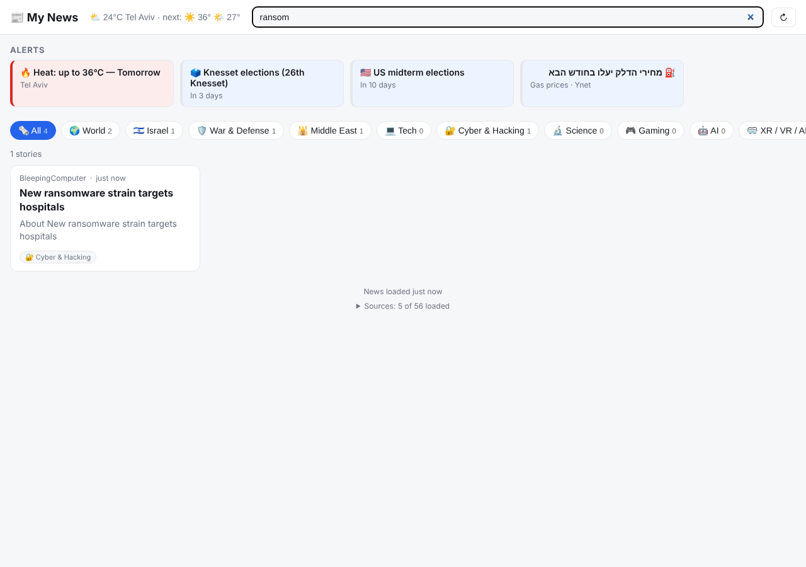

# My News: a personal news feed

A free, personal news dashboard with an **alerts bar** at the top and **topic feeds** below.
It loads fresh news when you open the page, and checks again every 5 minutes while it's open.



## What's in it

**Alerts** (top bar, sorted by urgency)
| Alert | Source |
|---|---|
| ⛈️ Weather: heat, cold, heavy rain, strong winds, storms for the next 3 days | [Open-Meteo](https://open-meteo.com) forecast + severe-weather headlines |
| 🕎 Jewish & Israeli holidays in the next 14 days | [Hebcal](https://www.hebcal.com) (Israel schedule) |
| 🗳️ Elections | Dates in `SPECIAL_DAYS` + election headlines |
| 🛍️ Sales: Black November, Singles Day 11.11, Black Friday, Cyber Monday | Computed automatically every year + sale headlines |
| ⛽ Gas prices | Fuel-price headlines (Hebrew & English) + a reminder before the monthly price update on the 1st |

**Topics**: World · Israel (Israeli sources only) · War & Defense · Middle East · Tech · Cyber & Hacking · Science · Gaming · AI · XR/VR/AR · AI Use Cases.

An article can appear in several topics. Each topic has its own feeds, and keywords pull in matching stories from any feed.

Click the weather in the header to change your city. The choice is saved in your browser.

## 100% free

No payments, ever. RSS feeds, Bing News RSS, Open-Meteo, Hebcal and Vercel's free (Hobby) plan cost nothing.

## How it works

- **Backend** (`api/feed.js` → `src/news.js`): fetches every feed on the server with a plain `fetch`, parses it, and returns one article list at `/api/feed`.
  - Publishers without a good feed use a **Bing News RSS search** limited to their site, made with `bing()` in the config. An article is kept only if its link really is on that publisher's site.
  - Results are cached for 2 minutes, so refreshing is instant.
- **Page** (`public/`): calls `/api/feed` when opened, then every 5 minutes while visible. Weather comes from Open-Meteo and holidays from Hebcal, both called directly.
- The **Sources** line at the bottom shows how many feeds loaded. Tap it to see which ones failed and why.

## Put it online (free, Vercel)

1. Go to https://vercel.com/signup and choose **Continue with GitHub** (Hobby plan, free, no card).
2. Click **Add New… → Project**, pick the `feed` repository, then click **Import**.
3. Leave the settings as they are and click **Deploy**.
4. After about a minute you get your address, like `https://feed-xxxx.vercel.app`.

Every push to `main` redeploys automatically.

## Customize

Everything lives in `public/js/config.js`:
- `TOPICS`: add or remove feeds and keywords per topic
- `HEADLINE_ALERTS`: keywords that promote a headline into the alerts bar
- `SPECIAL_DAYS`: your own dates (birthdays, elections, launches…)
- `WEATHER_THRESHOLDS`, `DEFAULT_LOCATION`

Add a source with `feed("Name", "site.com", "https://site.com/rss")`, or for sites without a feed, `bing("Name", "site.com", "site:site.com your search words")`.

## Run it on your own computer (optional, adds free local AI)

```bash
npm install
cp .env.example .env     # optional: enable free local AI
npm start                # → http://localhost:3000
```

Requires Node 22+. From your phone on the same Wi-Fi, use `http://<your-computer-ip>:3000`.

### Free local AI (Ollama)

Without AI, articles are sorted into topics by keyword. You can also run a free open model on your computer with [Ollama](https://ollama.com). It adds:
- more accurate topics, especially **AI Use Cases**
- an importance score and a "Most important" sort
- one-line English summaries, including for Hebrew stories
- a "✨ Your briefing" digest

```bash
# install Ollama from https://ollama.com, then:
ollama pull gemma3:4b
# in .env:
OLLAMA_MODEL=gemma3:4b
```

| Your computer | Model |
|---|---|
| 8 GB RAM | `gemma3:1b` |
| 16 GB RAM or an Apple M-series Mac | **`gemma3:4b`** (recommended) |
| 32 GB RAM or a 12 GB+ GPU | `gemma3:12b` |

The AI only works with the local version. Vercel's free plan can't run a model.
